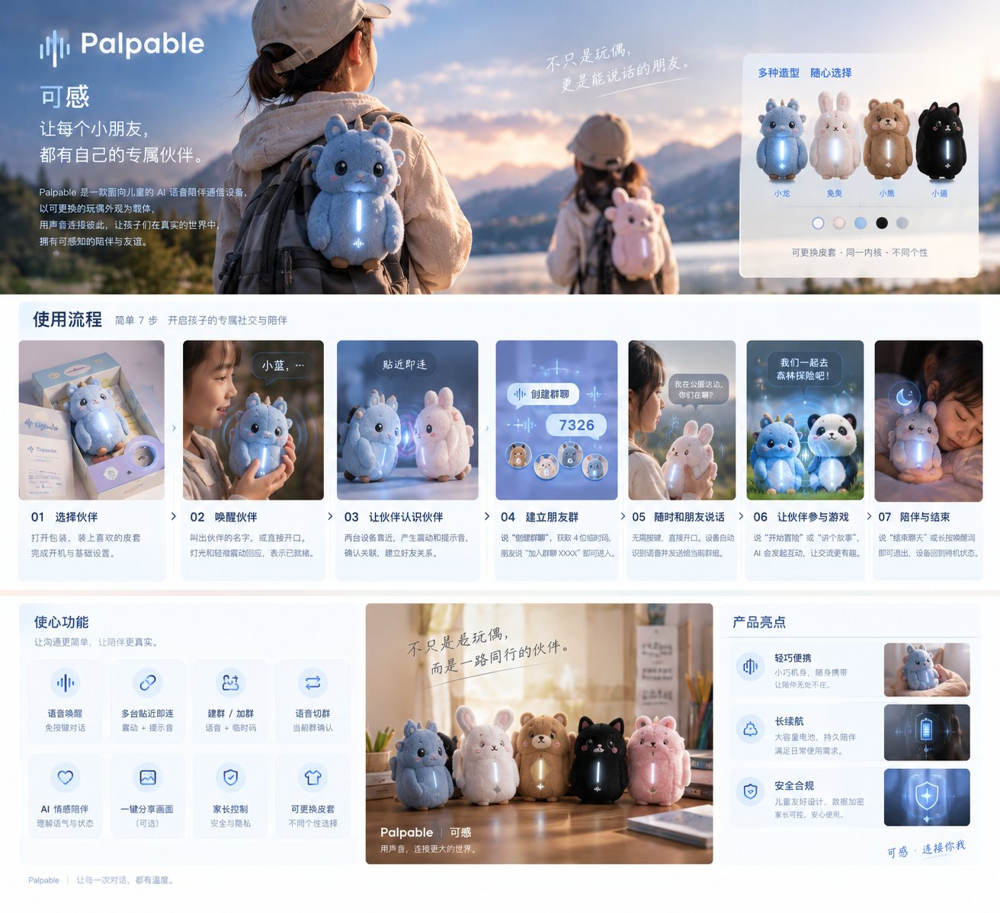

# 可感 Palpable

> 不只是玩偶，更是能说话的朋友。

**路演视频（约 10 分钟，含真人录制的完整演示）：** [观看 palpable-pitch.mp4](docs/assets/palpable-pitch.mp4)　·　一分钟简介：[palpable-demo.mp4](web/public/palpable-demo.mp4)


[](https://github.com/liuscraft/palpable/actions/workflows/ci.yml)

**可感（Palpable）是一台面向儿童的 AI 语音陪伴对讲机：** 以可更换的玩偶皮套为外观，没有复杂按键、没有需要盯着看的屏幕，孩子只需要**贴近、唤醒、说话**，就能和 AI 小伙伴聊天，也能和朋友用声音连在一起。



**演示视频（约 1 分钟）：** [观看 palpable-demo.mp4](web/public/palpable-demo.mp4)；官网首页「一分钟看懂可感」一节也内嵌了同一段视频。

## 目录

- [为什么做](#为什么做)
- [功能](#功能)
- [使用流程](#使用流程)
- [快速开始](#快速开始)
- [测试与覆盖率](#测试与覆盖率)
- [配置](#配置)
- [架构](#架构)
- [项目结构](#项目结构)
- [文档](#文档)
- [路线图](#路线图)
- [贡献](#贡献)
- [许可证](#许可证)

## 为什么做

低龄儿童没有手机，通用社交软件也没有为儿童设计默认边界。可感的思路是：

| 与手机 / 微信语音相比 | 可感的做法 |
| --- | --- |
| 孩子不需要手机 | 一个玩偶就是入口，没有账号、没有界面 |
| 找 App、翻列表 | 抱着就能说，靠近就能连 |
| AI 是插件 | AI 是孩子的陪伴者，也是他和朋友之间的桥梁 |
| 默认开放 | **陌生设备互相屏蔽**，好友关系经确认才生效，家长可控 |

同一个硬件核心配不同皮套（小龙、兔兔、小熊、小猫等），对应不同风格的智能体，"同一个内核，不同个性"。

## 功能

- **语音唤醒**：免按键，叫伙伴的名字即可对话，可随时打断
- **贴近即连**：设备靠近，震动 + 提示音确认，建立好友关系
- **区域 / 群语音频道**：进入公园等区域可加入区域频道；4 位数字码建群、加群
- **AI 情感陪伴与游戏**：理解语气，讲故事、主持语音游戏
- **家长控制**：好友确认、录音与摘要查看
- **可更换皮套**：外观与个性可选

> 以上为产品设计目标，实际完成度以 [docs/tasks.md](docs/tasks.md) 为准。当前阶段设备由 Web 页面模拟，尚无真实硬件。

## 使用流程

1. 选择伙伴：开箱，选一款皮套
2. 唤醒伙伴：叫它的名字，灯光与震动表示就绪
3. 让伙伴认识伙伴：两台设备靠近，确认关联
4. 建立朋友群：说"创建群聊"获得 4 位码，朋友说"加入群聊 XXXX"
5. 随时和朋友说话：无需按键，语音自动发送到当前群组
6. 让伙伴参与游戏：说"开始冒险"或"讲个故事"
7. 陪伴与结束：说"结束聊天"，设备回到待机

演示主线（M2 + M3）：开箱 → 命名认主 → 公园区域频道 → 贴近成为好友 → 好友互相听见。

## 快速开始

**前置要求：** Go（版本见 `server/go.mod`）、Node.js 22、pnpm 10。浏览器音频依赖 WebCodecs，请使用 Chrome / Edge；麦克风需要 `localhost` 或 HTTPS。

```bash
# 1. 启动后端（默认 :8080，设备端点 /ws，健康检查 /healthz）
cd server && go run ./cmd/palpabled

# 2. 另开终端，启动 Web 设备模拟器（/ws 自动代理到本地网关）
cd web && pnpm install && pnpm dev
```

不配置灵矽时，设备档案在本地开通、频道对讲照常可用，但**没有 AI 对话**。接入 AI 见下节。

### 演示怎么走

打开 `http://localhost:5173`（服务端配置里打开 `demo.world` 与 `demo.parent_token`，见 `server/config.example.yaml`）：

1. **开箱**：点盒子 → 抱出来 → 放到桌面上。
2. **命名认主**：玩偶自动上线，小可打招呼；打开麦克风对它说出两个名字。灵矽暂时不可用时，用"演示：替小朋友说出名字"。
3. **公园区域频道**：切到公园，把玩偶拖进公园，小伙伴询问是否加入（或点"加入"）。
4. **贴近成为好友**：点"再来一个小朋友"开第二只玩偶（或另开浏览器窗口 `?device=<mac>`），把两只拖到一起，在下方家长端点"确认"。
5. **好友互相听见**：两只都加入公园频道后，好友到场有提醒；对一只说话，另一只播放（需要两个麦克风时用两个浏览器窗口）。陌生人在地图上标"已屏蔽"，听不到也看不到。

页面下方还有其他功能（建群、切群、分享）、设备皮套（点一款即换皮套并切换风格小伙伴）与家长端。

全量检查（协议类型生成、前端 lint、Go vet、单测覆盖率、前后端构建）：

```bash
make check
```

Windows 没有 `make` 时，请在 `web`、`server` 目录分别执行 Makefile 中对应的命令。

## 测试与覆盖率

PR 要求后端单测覆盖率 **≥ 90%**：`make check` 与 CI 都会执行 `make cover`，低于门槛直接失败。覆盖率只统计 `server/internal`（`cmd/palpabled` 只是装配入口，不纳入），`web/` 目前还没有单元测试。

推送到 `main` 后，CI 会把最新覆盖率写入 [`badges`](https://github.com/liuscraft/palpable/tree/badges) 分支的 `coverage.svg`，README 顶部的徽章即取自该文件。PR 的覆盖率报告可从 Actions 的 `go-coverage` artifact 下载。

本地测量并查看逐文件报告：

```bash
make cover
```

```bash
cd server && go tool cover -html=coverage.out
```

## 配置

AI 对话通过灵矽（xrobotd / linxd）接入，所有密钥只放**服务端 YAML 配置文件**（`server/config.yaml`，已被 `.gitignore` 忽略），禁止出现在 `web/` 或提交到仓库。

复制 `server/config.example.yaml` 为 `server/config.yaml` 后修改；也可用 `palpabled -config <path>` 指定路径。文件不存在时用默认值启动（不启用 AI 对话）。

| 键 | 说明 |
| --- | --- |
| `addr` | 监听地址，默认 `:8080` |
| `linx.ws_url` | 灵矽 WebSocket 地址，例如 `wss://xrobo-io.qiniuapi.com/v1/ws/`；为空则不启用 AI 对话 |
| `linx.token` | Bearer 令牌，WebSocket 与 REST 共用 |
| `linx.api_base` | 灵矽 REST 地址，默认 `https://xrobo.qiniu.com` |
| `linx.voiceprint_base` | 声纹服务地址（演示环境） |

| `linx.ota_url` | 灵矽 OTA 地址，用于激活预注册的设备 |
| `demo.guardian` / `demo.guardian_name` | 演示：新设备自动绑定到这个家长 |
| `demo.voice_consent` | 演示：预置监护人对声纹登记的同意 |
| `demo.parent_token` | 家长端 `/api` 的令牌，代表 `demo.guardian`；为空则不开放家长端 |
| `demo.world` | 开放 `/world` 演示地图；会暴露所有设备位置，默认关闭 |

演示模式下若灵矽暂时不可用（小伙伴听不到），可用页面上的"演示：替小朋友说出名字"与公园里的"加入"按钮代替孩子的口头指令：它们调用 `POST /world/tool`，服务端执行与 AI 调用相同的业务工具，规则照旧由服务端裁决。

设备以自己的 MAC 作为 `Device-Id` 连灵矽（Web 模拟器首次打开时生成并存在浏览器里，`?device=<mac>` 可指定）。服务端启动时自动在灵矽创建"可感·小可"等五个智能体；新设备上线时自动预注册并经 OTA 激活，随即可以对话。若 OTA 不可达（日志 `activate device via ota`），在灵矽控制台把该 MAC 绑定到"可感·小可"即可。

## 架构

Web 模拟器与未来固件是**同一份协议的两个客户端**。设备端只做"传感器和执行器"，所有业务规则（谁能听见谁、好友、频道、认主、家长控制）都在服务端。

```
设备（Web 模拟器 / 未来固件）
        │  WebSocket /ws：JSON 控制消息 + Opus 音频帧（16kHz、单声道、60ms）
        ▼
服务端 palpabled（Go）── 接入 → 编排 → 能力 → 领域 → 基础（依赖只向下）
        │
        └── 灵矽：AI 对话、TTS、智能体
```

- 协议以 [`protocol/palpable.schema.json`](protocol/palpable.schema.json) 为单一事实来源，前端 TS 类型由其生成（`make gen`）
- 详见 [docs/architecture.md](docs/architecture.md) 与 [docs/modules/](docs/modules/README.md)

| 层 | 选型 |
| --- | --- |
| 后端 | Go、`net/http`、`gorilla/websocket`、`log/slog`；存储计划用 SQLite（`modernc.org/sqlite`） |
| 前端 | React 19、TypeScript（strict）、Vite、three / react-three-fiber、zustand、Tailwind CSS |
| 音频 | Opus，16kHz，单声道，60ms 帧 |

## 项目结构

```
palpable/
├── protocol/   设备协议 schema 与文档（单一事实来源）
├── server/     Go 后端
├── web/        Web 设备模拟器与演示页面
├── firmware/   预留：未来硬件固件
└── docs/       产品、架构、模块、灵矽对接、路线图
```

## 文档

从 [docs/README.md](docs/README.md)（文档地图与术语表）开始。

| 文档 | 内容 |
| --- | --- |
| [docs/product.md](docs/product.md) | 做什么、为谁、为什么 |
| [docs/architecture.md](docs/architecture.md) | 系统边界、分层、关键决策 |
| [docs/modules/](docs/modules/README.md) | 各模块契约 |
| [docs/linx-integration.md](docs/linx-integration.md) | 灵矽能力与限制 |
| [docs/tasks.md](docs/tasks.md) | 路线图与完成状态 |
| [protocol/README.md](protocol/README.md) | 设备协议 |
| [AGENTS.md](AGENTS.md) | 编码规则与隐私硬约束 |

## 路线图

| 阶段 | 目标 |
| --- | --- |
| M0 | 骨架：协议、网关、Web 设备模拟器 |
| M1 | 设备经后端与灵矽对话，灯带随状态变化 |
| M2 | 命名认主：设备自动开通、开箱、起名 |
| M3 | 语音主线：公园频道、陌生人屏蔽、贴近成为好友 |
| M4 | 群聊、画面分享、家长端、设备工具 |
| 之后 | 真实硬件、皮套系列、微信小程序、声纹认主、B 端车队版 |

完成状态只记在 [docs/tasks.md](docs/tasks.md)。

## 贡献

1. 阅读 [AGENTS.md](AGENTS.md)，尤其是"第一原则"和"儿童隐私与安全"
2. 新增设备行为时顺序为：`protocol/` → 服务端 → Web 模拟器
3. 提交前运行 `make check`，全部通过再提交 PR
4. 一次提交只做一件事；不得提交 `.env`、密钥、声纹原始音频

<!-- TODO: 补充 Issue / PR 模板、行为准则、联系方式 -->

## 许可证

[Apache License 2.0](LICENSE)

## TODO：需要补充的信息

1. 演示 GIF（海报已放在 `docs/assets/poster.jpg`）
2. 项目的正式对外链接（官网、Demo 地址、仓库地址徽章）
3. 灵矽的获取与预注册流程（是否有公开文档链接）
4. 隐私承诺的对外表述是否需要在 README 中单独成节
5. 反馈渠道（Issue、邮箱或社群）
